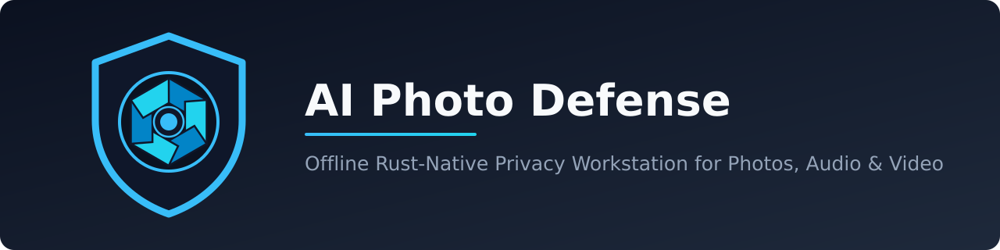
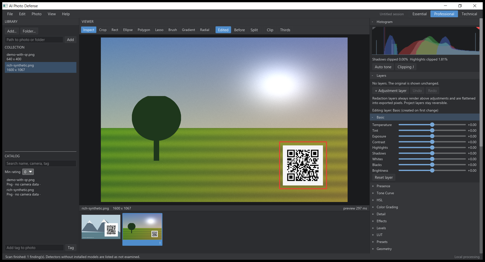

# AI Photo Defense

Offline, Rust-native privacy workstation for photographs and other finished media: professional photo editing and colour correction, local Privacy Scan, permanent redaction, verified export, audio/video/subtitle metadata inspection and removal, spoken-content muting, diagnostics and crash recovery, plus an experimental adversarial-defense research bench. Development preview, not a validated protection product.

The desktop application imports photographs and folders, scans them locally for privacy findings (metadata, QR codes and barcodes, credentials and personal data in decoded text), edits and redacts them non-destructively, and exports flattened, metadata-free copies that are reopened and verified before they are saved. A separate optional CLI experiment optimizes a real CLIP image encoder using input gradients. No defense against editing, face swapping, identity cloning, recognition training or generative training has yet been independently demonstrated by this project. No photograph can be guaranteed immune to manipulation.

## Working today

Part 5 (0.5.0) is a refinement and validation pass: text-field rendering fix, weak-blur warnings, AIFF/CAF/MP2 audio, an invisible ownership watermark ([guide](docs/guides/WATERMARK.md)) and a master checklist of every requirement with its real status ([implementation matrix](docs/IMPLEMENTATION_MATRIX.md#part-5)).

Part 4 (0.4.0) adds a multimedia privacy foundation, deliberately not a video editor: content-based detection of about 45 formats; MP4/MOV/3GP/M4A and MKV/WebM inspection (tracks, codecs, GPS, device and other metadata); lossless MP4-family metadata removal with chunk-level verification; streamed audio decoding (WAV, FLAC, MP3, AAC/M4A, ALAC, Ogg Vorbis) with loudness, true peak, waveform and spectrogram; mute/bleep redaction with verified WAV export and loudness-matched A/B listening; SRT/WebVTT Privacy Scan and redaction; BMP and GIF import. Video decoding, AI voice/video protection and speech-to-text are **not** available; the audio protection engine exists but refuses to run without a validated model. Details: [format compatibility](docs/FORMAT_COMPATIBILITY.md), [audio](docs/guides/AUDIO_PROTECTION.md) and [video](docs/guides/VIDEO_PROTECTION.md) guides, [research register](docs/research/MULTIMEDIA_RESEARCH_REGISTER.md).

Part 3 added: a redesigned native interface with three distinct modes (Essential processing list, Professional dockable workspace with library, viewer, filmstrip and inspector, Technical diagnostics/performance/forensics pages); Color Studio (linear-light white balance and exposure, tone, curves, HSL, grading, LUT import/export, presets, histogram and clipping warnings); adjustment layers with gradient, radial and selection masks, blend modes and opacity; perspective, lens and canvas corrections; RAW files via their embedded camera preview; SQLite Media Manager; structured, privacy-sanitised local logging; autosave and crash recovery; high-assurance export review; read-only forensic inspection. See [HANDOFF.md](HANDOFF.md) for exactly what was verified.


- Essential, Professional and Technical modes share one collection and one edit stack per photograph. Workspaces: Batch Export, Privacy Scan, Edit and Redact, AI Defense (status), Protection History, Defense Lab, Model Library, Settings.
- Non-destructive editing: crop (freeform, selection, 1:1, 4:3, 3:2, 16:9, 9:16, 4:5, custom), rotate, straighten, flip, resize/fit social presets, undo/redo and history.
- Selections (rectangle and ellipse by mouse drag or coordinates; polygon, lasso and brush in the engine and recipes) with Gaussian blur, pixelation and mosaic (visual concealment) or opaque black/white/custom redaction (secure). Background concealment by inverting a selection.
- Local Privacy Scan: EXIF/GPS/device/timestamps, XMP, IPTC, ICC, comments, thumbnails, multi-picture and trailing embedded images, multi-page/animated files; QR, Data Matrix, PDF417, Aztec and 1-D codes (decoded locally, never opened); 45+ credential and personal-data rules with checksum validation, evidence levels and US/UK/Canada rules; 12 privacy profiles plus custom JSON profiles. Findings never contain the sensitive value.
- Secure export pipeline with final verification of the encoded bytes: metadata, remaining credential codes, redaction completeness and hidden colour under transparency. Failing exports are blocked unless you explicitly accept the reviewed findings.
- Batch processing of files and folders (recursive, symlinks never followed, duplicates skipped, review queue by default, explicit auto-redaction, cancel, unique output names, polling folder watch in the CLI).
- Local JPEG, PNG, WebP and TIFF decoding with file, dimension, pixel and allocation limits.
- Drag-and-drop and file-dialog import; command-line paths can also open in the desktop app.
- Batch export without overwriting originals or existing destinations.
- EXIF orientation applied before metadata-free re-encoding; source EXIF/GPS, XMP and ICC are not copied.
- Before/export comparison, zoom and pan, absolute difference visualization.
- PSNR, RGB MSE, windowed luminance SSIM and maximum channel delta measured on decoded exports.
- JPEG, lossless WebP, resize, crop and Gaussian-blur transformation measurements and JSON reports.
- CPU joint projected-gradient optimizer with a shared perturbation budget, model weighting and cancellation.
- Optional experimental Candle CLIP ViT-B/32 feature suppression adapter and CLI.
- Local safetensors checksum/structure verification with explicit code and weight license records.
- Light, dark and startup system theme detection. Professional browser width adjustment and inspector collapse.

## Current boundaries

Export removes metadata and applies your edits and redactions. It does not run the experimental CLI defense. No validated defense model is installed. Face, person, object, document, screen and licence-plate detection and OCR of text in the pixels are **not available** until verified local models are licensed and integrated; every scan lists these as not examined. Automated scanning never guarantees privacy. Quick/Balanced/Maximum protection presets are not enabled because their effectiveness has not been measured. Watermarking, C2PA, model downloads, signed updates, GPU inference, folder monitoring, SQLite history, full docking and persisted collections remain unfinished. Technical mode measures image transformations; it does not run face swaps or AI editors.

Only 8-bit images are accepted. Color management is pending: dropping an ICC profile can change appearance, especially for wide-gamut photographs. Work on copies and inspect exported colors before sharing. Multi-page TIFF and animated inputs export only the first image/frame. JPEG rejects transparency. The transformation lab currently requires opaque images for JPEG tests. RAW files open through their embedded camera preview only (no RAW development). HEIC/HEIF and AVIF are detected but not decoded.

## Build and run

Install [Rust](https://rustup.rs/). The repository pins Rust 1.100.0 and commits Cargo.lock. See [installation](docs/INSTALLATION.md) for platform requirements and verification status.

```sh
cargo run --locked -p photo-desktop
cargo run --locked -p photo-desktop -- --mode professional photo.png
cargo run --locked -p photo-cli -- inspect photo.png
```

Create the output directory first. Export creates an image and a JSON report per input:

```sh
mkdir exports
cargo run --locked -p photo-cli -- export photo.png --output-dir exports --format png
cargo run --locked -p photo-cli -- compare photo.png exports/photo-private.png
cargo run --locked -p photo-cli -- lab photo.png exports/photo-private.png --report exports/lab.json
cargo run --locked -p photo-cli -- scan photo.png --profile "Cybersecurity"
cargo run --locked -p photo-cli -- process photo.png -o exports --aspect 4:5 --fit 1080x1350 --redact 40,60,200,80 --auto-redact
cargo run --locked -p photo-cli -- batch ./photos -o exports --recursive --profile "Home Privacy"
cargo run --locked -p photo-cli -- profiles "Travel" > travel.json
cargo run --locked -p photo-cli -- media-inspect clip.mov
cargo run --locked -p photo-cli -- strip-video clip.mov -o exports/clip-clean.mov
cargo run --locked -p photo-cli -- audio-export talk.mp3 -o exports/talk.wav --bleep 12.5-14
cargo run --locked -p photo-cli -- subtitles episode.srt --redact-to exports/episode.srt
cargo run --locked -p photo-cli -- watermark-embed photo.png -o exports/marked.jpg --payload 123456 --format jpeg   # passphrase in APD_WATERMARK_KEY
```

[User guide](docs/USER_GUIDE.md) explains workspaces, shortcuts, limits and report interpretation. [Experimental CLIP guide](docs/EXPERIMENTAL_CLIP.md) explains how to build the optional model experiment. It is not a production protection preset.

## Actual software screenshots

Captures of the running Windows 10 build (this version) using the original CC0 synthetic calibration illustration with a fake Wi-Fi QR code added for testing. They show privacy scanning, redaction and verified export, not demonstrated AI protection.



[Essential](docs/screenshots/part3-essential.png) | [Diagnostics](docs/screenshots/part3-technical-diagnostics.png) | [Performance](docs/screenshots/part3-technical-performance.png) | [Forensics](docs/screenshots/part3-technical-forensics.png) | [Light theme and menu](docs/screenshots/part3-light-photo-menu.png) | [Smaller window](docs/screenshots/part3-small-window.png)

Part 2 captures: [Privacy Scan](docs/screenshots/privacy-scan.png)

[Edit and Redact](docs/screenshots/edit-redact.png) | [Verified export](docs/screenshots/export-verified.png) | [AI Defense status](docs/screenshots/technical-ai-defense.png)

Earlier Linux captures of version 0.1: [Essential](docs/screenshots/essential.jpg), [Professional](docs/screenshots/professional.jpg), [Technical](docs/screenshots/technical.jpg).

## Validation

```sh
cargo fmt --all --check
cargo test --locked --workspace --all-features
cargo clippy --locked --workspace --all-targets --all-features -- -D warnings
cargo build --locked --workspace --all-features
cargo audit
cargo deny check
```

See [testing](docs/TESTING.md), [security review](docs/SECURITY_REVIEW.md) and [handoff](HANDOFF.md) for actual results and unresolved blockers. CI builds are verification artifacts, not signed public releases. Downloadable production releases will follow platform runtime testing, dependency remediation and defense validation.

## Documentation

- [Master specification](docs/MASTER_SPECIFICATION.md), [Part 3 specification](docs/PART3_SPECIFICATION.md) and [implementation matrix](docs/IMPLEMENTATION_MATRIX.md)
- [User guides](docs/guides/README.md), [design evaluation](docs/design/PART3_DESIGN.md), [benchmarks](docs/BENCHMARKS.md)
- [Camera compatibility](docs/CAMERA_COMPATIBILITY.md), [hardware compatibility](docs/HARDWARE_COMPATIBILITY.md), [Part 4 specification](docs/PART4_SPECIFICATION.md), [archived video-editor concept](docs/archive/DEFERRED_VIDEO_EDITOR_CONCEPT.md)
- [Development handoff](HANDOFF.md)
- [Architecture and SDK](docs/ARCHITECTURE.md)
- [Model licensing register](docs/research/MODEL_LICENSES.md)
- [Research and licensing audit](docs/research/AUDIT.md)
- [Design review](docs/design/REVIEW.md)
- [Threat model](docs/THREAT_MODEL.md)
- [Security policy](SECURITY.md) and [privacy policy](PRIVACY.md)
- [Roadmap](ROADMAP.md), [changelog](CHANGELOG.md), [contributing](CONTRIBUTING.md)
- [Third-party notices](THIRD_PARTY.md)

MIT license applies to this repository's original code. It does not relicense referenced research, model weights, datasets or dependencies.
