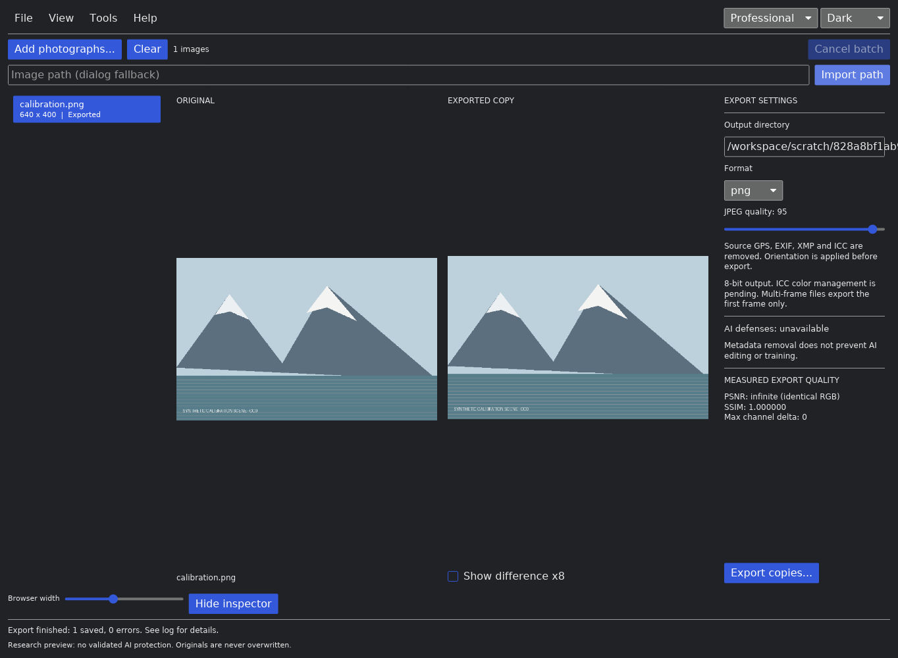

# AI Photo Defense

Offline Rust desktop utility and research workbench for photograph privacy and adversarial image defense. Development preview, not a validated protection product.

The desktop application imports images, exports metadata-free copies, compares decoded pixels and runs transformation measurements. A separate optional CLI experiment optimizes a real CLIP image encoder using input gradients. No defense against editing, face swapping, identity cloning, recognition training or generative training has yet been independently demonstrated by this project. No photograph can be guaranteed immune to manipulation.

## Working today

- Essential, Professional and Technical workspaces share one in-memory collection.
- Local JPEG, PNG, WebP and TIFF decoding with file, dimension, pixel and allocation limits.
- Drag-and-drop and file-dialog import; command-line paths can also open in the desktop app.
- Batch export without overwriting originals or existing destinations.
- EXIF orientation applied before metadata-free re-encoding; source EXIF/GPS, XMP and ICC are not copied.
- Before/export comparison, zoom and pan, absolute difference visualization.
- PSNR, RGB MSE, windowed luminance SSIM and maximum channel delta measured on decoded exports.
- JPEG, lossless WebP, resize, crop and Gaussian-blur transformation measurements and JSON reports.
- CPU joint projected-gradient optimizer with a shared perturbation budget, model weighting and cancellation.
- Optional experimental Candle CLIP ViT-B/32 feature suppression adapter and CLI.
- Local safetensors checksum/structure verification with explicit code and weight license records.
- Light, dark and startup system theme detection. Professional browser width adjustment and inspector collapse.

## Current boundaries

The desktop export button removes metadata. It does not run the experimental CLI defense. No validated defense model is installed. Quick/Balanced/Maximum protection presets are not enabled because their effectiveness has not been measured. Watermarking, C2PA, model downloads, signed updates, GPU inference, folder monitoring, SQLite history, full docking and persisted collections remain unfinished. Technical mode measures image transformations; it does not run face swaps or AI editors.

Only 8-bit images are accepted. Color management is pending: dropping an ICC profile can change appearance, especially for wide-gamut photographs. Work on copies and inspect exported colors before sharing. Multi-page TIFF and animated inputs export only the first image/frame. JPEG rejects transparency. The transformation lab currently requires opaque images for JPEG tests. RAW and HEIC are not supported.

## Build and run

Install [Rust](https://rustup.rs/). The repository pins Rust 1.100.0 and commits Cargo.lock. See [installation](docs/INSTALLATION.md) for platform requirements and verification status.

```sh
cargo run --locked -p photo-desktop
cargo run --locked -p photo-desktop -- --workspace professional photo.png
cargo run --locked -p photo-cli -- inspect photo.png
```

Create the output directory first. Export creates an image and a JSON report per input:

```sh
mkdir exports
cargo run --locked -p photo-cli -- export photo.png --output-dir exports --format png
cargo run --locked -p photo-cli -- compare photo.png exports/photo-private.png
cargo run --locked -p photo-cli -- lab photo.png exports/photo-private.png --report exports/lab.json
```

[User guide](docs/USER_GUIDE.md) explains workspaces, shortcuts, limits and report interpretation. [Experimental CLIP guide](docs/EXPERIMENTAL_CLIP.md) explains how to build the optional model experiment. It is not a production protection preset.

## Actual software screenshots

These are captures of a running Linux build using an original synthetic calibration illustration. They show metadata export and quality measurements, not demonstrated AI protection.



[Essential workspace](docs/screenshots/essential.jpg) | [Technical workspace](docs/screenshots/technical.jpg)

## Validation

```sh
cargo fmt --all --check
cargo test --locked --workspace --all-features
cargo clippy --locked --workspace --all-targets --all-features -- -D warnings
cargo build --locked --workspace --all-features
cargo audit
```

See [testing](docs/TESTING.md), [security review](docs/SECURITY_REVIEW.md) and [handoff](HANDOFF.md) for actual results and unresolved blockers. CI builds are verification artifacts, not signed public releases. Downloadable production releases will follow platform runtime testing, dependency remediation and defense validation.

## Documentation

- [Architecture and SDK](docs/ARCHITECTURE.md)
- [Research and licensing audit](docs/research/AUDIT.md)
- [Design review](docs/design/REVIEW.md)
- [Threat model](docs/THREAT_MODEL.md)
- [Security policy](SECURITY.md) and [privacy policy](PRIVACY.md)
- [Roadmap](ROADMAP.md), [changelog](CHANGELOG.md), [contributing](CONTRIBUTING.md)
- [Third-party notices](THIRD_PARTY.md)

MIT license applies to this repository's original code. It does not relicense referenced research, model weights, datasets or dependencies.
